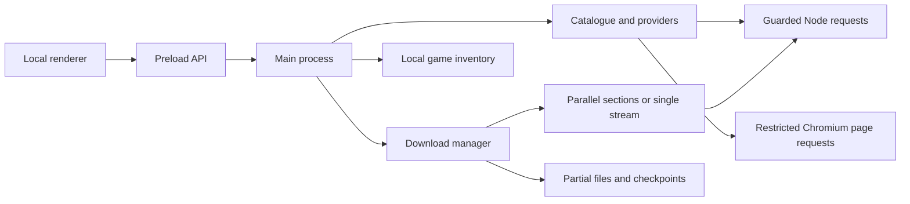
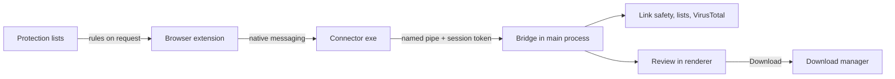

# Architecture

Ravenshelf is a Windows Electron application. The interface uses HTML, CSS and plain JavaScript; the main process uses CommonJS modules. There is no Ravenshelf account service or hosted backend.

## Main components

| Component | Responsibility |
| --- | --- |
| `src/main.cjs` | Application lifecycle, local protocol, validated IPC handlers, windows, profile persistence and OS integration. |
| `src/preload.cjs` | Exposes the fixed `window.atlas` API through Electron's context bridge. |
| `src/renderer/` | Catalogue, game details, collections, installed-game view, PC specs, Mods page, queue, preferences and dialogs. `i18n.js` translates and fills in texts for the window and the main process. |
| `src/i18n.cjs`, `src/locales/ar.json` | The language setting, the Arabic texts (read once; a damaged file gives English) and the `locale.js` data the window is served with. `main.cjs` translates notifications, file dialogs, window titles and the Alt menu. `src/browser-extension/text.js` holds the extension's English and Arabic texts. |
| `src/catalog.cjs` | Catalogue sections, source-page parsing, search, caching and related resource links. |
| `src/catalog-refresh.cjs` | Main-process refresh scheduling, coalescing and last-successful catalogue state. |
| `src/providers.cjs` | Source-page/link expansion, supported paste decryption and file-host resolution. |
| `src/fast-session.cjs` | Uses an isolated Chromium session for supported FuckingFast page/form requests, without opening a page or evaluating scripts. |
| `src/ff-policy.cjs` | Supported FuckingFast endpoints, redirect boundaries and selected filename checks. |
| `src/net.cjs` | HTTPS validation, redirect handling and socket-level public-address checks for Node file requests. File transfers use HTTP/1.1 so that each section of a split download has its own connection. |
| `src/image-loader.cjs` | Bounded raster-image requests through the guarded Node transport, without browser-session credentials. |
| `src/downloads.cjs` | Persistent queue, file concurrency, pause/resume, URL refresh, transfer state and completed-file publication. |
| `src/defender-scan.cjs` | Finds Microsoft Defender's `MpCmdRun.exe`, launches a scan asynchronously and conservatively interprets its output without changing Defender settings. The download manager serializes scan jobs. |
| `src/header-vault.cjs` | Seals saved download request headers (cookies, referrers) with Windows account encryption through Electron `safeStorage`. |
| `src/parallel-download.cjs` | Section requests, resource validators, durable section checkpoints and single-stream fallback. |
| `src/rate-meter.cjs` | Recent transfer-rate measurement over a five-second window. |
| `src/installed-games.cjs`, `src/installed-scan.ps1` | Bounded, read-only inventory of installed-game records, manifests and executable version metadata. |
| `src/hardware.cjs`, `src/hardware-probe.ps1` | The **PC specs** page: a fixed, read-only Windows PowerShell probe run on request, and the checks that turn its untrusted answer into processor, graphics, memory, drive, display and Windows details. |
| `src/compatibility.cjs` | **Can you run it?**: reads a game's requirement lists and compares the figures in them with the PC specs answer (pure functions, no files, programs or network). |
| `src/completion-action.cjs` | Session-only completion rules and cancellable countdown; OS execution is supplied by the main process. |
| `src/completion-policy.cjs` | Shared transfer/scan readiness checks used before the completion countdown and again at the final action boundary. |
| `src/feature-services.cjs` | Main-process integration and validated operations for the 0.4.0 features. |
| `src/bandwidth-limiter.cjs`, `src/download-schedule.cjs`, `src/host-backoff.cjs` | One transfer budget across streams, local-time schedule boundaries and per-host cooldowns. |
| `src/download-cleanup.cjs` | Expiring cleanup previews, managed-file identity validation and partial-failure reporting. |
| `src/archive-set-validation.cjs` | Recognized archive numbering, duplicates and known-size consistency checks. |
| `src/integrity-verifier.cjs`, `src/integrity-worker.cjs` | Bounded SFV/MD5/SHA-256 parsing and cancellable file hashing in a worker. |
| `src/app-updater.cjs`, `src/updater-helper.cs` | Restricted GitHub release selection, approval-gated and hash-checked staging, profile backups, leftover cleanup and native portable replacement. |
| `src/release-attestation.cjs` | Verifies a release's Sigstore build record against the pinned release-workflow identity, with a TUF-refreshed trusted root and a bundled fallback. |
| `src/game-metadata.cjs`, `src/clipboard-inbox.cjs`, `src/notifications.cjs` | Public Steam details, opt-in local copied-link recognition and local desktop notices. |
| `src/browser-extension/` | The Chrome/Edge/Brave/Firefox extension: download capture, declarative blocking rules, the file-host guard, the toolbar popup and the warning page. `policy.js` holds its pure decisions. |
| `src/browser-host.cs` | Native-messaging connector: relays one extension message to the app over a token-protected named pipe. |
| `src/browser-protocol.cjs`, `src/browser-bridge.cjs` | The app side of the extension: framing, origin and token checks, request validation, quick decisions and the review queue. |
| `src/browser-setup.cjs`, `src/browser-integration.cjs` | Extension folders, per-user connector registration and the Settings operations. |
| `src/threat-lists.cjs`, `src/link-safety.cjs` | Public protection lists (download, validation, lookup, browser rules) and link and file checks before downloading. |
| `src/virustotal.cjs`, `src/motw.cjs` | Optional VirusTotal lookups (domains and file fingerprints) and the internet-zone mark on taken-over files. |
| `src/mods.cjs` | Validation of the game-and-mod label the extension attaches to a file downloaded on Nexus Mods, and the `Mods\<game>` folder rule. `src/browser-extension/nexus.js` is the read-only page script. |
| `src/safe-name.cjs` | The one place where file and folder names from web pages and servers are made safe for Windows. The checks that judge a file by its name judge the name in this form: the browser bridge hands the queue the name as it arrived and judges `safeName()` of it, which is exactly what the queue saves it as. Folder names are cut to 100 characters and tidied again after the cut; a game whose folder an earlier version made without that tidying keeps its folder (`add` in `src/downloads.cjs`). |
| `src/youtube.cjs`, `src/media-tools.cjs`, `src/media-downloads.cjs`, `src/media-integration.cjs` | YouTube downloads: address parsing and quality choices, the pinned and hash-checked helper programs (yt-dlp, Deno, FFmpeg, downloaded in checked 2 MiB parts over up to eight connections), the yt-dlp runner, and the setup, waiting requests and Settings operations. `src/browser-extension/youtube.js` is the player button. |

## Application and network boundaries

The main page is served from `atlas://app/index.html` through a small resource allowlist. It runs with context isolation and sandboxing enabled and Node integration disabled. IPC checks that calls originate from this window's expected main frame. Catalogue text is rendered as text, not injected as source HTML. Covers use an app image route backed by the guarded Node transport; the renderer's content policy blocks direct remote images. The loader checks public addresses and redirects, limits response size/time and accepts supported raster images. Image hosts still receive normal network requests and see the connection IP.

Protected host windows use host-specific sessions and do not load the application preload. They execute remote page scripts inside the browser sandbox, deny permissions and new popup windows, restrict navigation and network requests, and intercept supported archive downloads into the queue. The separate gameplay viewer also lacks download/file-control access. External links opened in the user's browser are governed by that browser's own settings.

The FuckingFast session adapter reads only supported root landing-page and matching form endpoints. It validates redirects, caps request lifetime and shares that host's verification session. It does not execute remote page scripts. Direct-file probes and file transfers continue through the Node transport. Chromium root-host DNS preflight is distinct from the Node transport's socket-level address validation; neither is a content-malware verdict.

The packaged executable switches off Electron's `RunAsNode`, `NODE_OPTIONS`, `--inspect` and `file://` privilege fuses, loads application code only from `app.asar`, and encrypts the Chromium cookie store. Version 0.3.1 also enables `EnableEmbeddedAsarIntegrityValidation` alongside `OnlyLoadAppFromAsar`. `npm run verify:build` inspects the actual packaged fuse values rather than relying only on build configuration. These restrictions reduce execution and archive-tampering paths; they do not authenticate the unsigned executable or prevent replacement of the whole application. Public releases use GitHub-hosted runners and build-provenance attestations.

## Browser extension

The extension never fetches anything itself. For each browser download it asks the app, through the connector, for a quick answer: **take** (the browser cancels and erases its copy), **block**, or **browser** (the browser keeps it: the app is closed, the link is unencrypted, or the user allowed it once). Chrome holds the download in `onDeterminingFilename`; Firefox has no such hook, so the extension pauses the new download while it asks. Taken downloads are inspected in the background (two at a time) and wait in the review until the user decides.

The connector is started by the browser per message. It reads `endpoint.json` beside it for the current pipe and token, sends a header frame `{v, token, origin}` and the request, and returns the app's reply (at most 1 MB). The app rejects any connection without the token or from an origin other than Ravenshelf's pinned extensions.

The extension also asks for the protection lists' browser rules: domains only, chunked under the native-messaging reply limit (IDs 1–999), plus a redirect rule (ID 1000) that blocks main-frame navigations started by FuckingFast and FileKeeper pages toward other domains, and an allow rule (ID 1001) used while protection is off or paused. Pop-ups from those pages are closed through navigation events, and a navigation that gets past the rule (an ad frame taking over the tab, or a server redirect) is undone when it commits.

### Nexus Mods files

`nexus.js` runs in the top frame of www.nexusmods.com pages, never in private windows, and only reads: the page's address, its `og:title`, `og:site_name` and `og:url` lines, the game and mod numbers on `#section`, and the `file-id`, `filename`, `file-uri`, `game-id` and `game-name` attributes of up to 20 `mod-file-download` boxes. It looks every two seconds while the tab is visible and reports to the background only when what it reads has changed, again (at most every 20 seconds) after a click or an Enter or Space key press of yours, and again after 20 minutes on a page kept open. A report with no answer is given up after 30 seconds. A report counts as sent only when the background answers `ok`; otherwise it is tried again after 10 seconds. On a page that is not a mod's page it reports `page: null`, and the background forgets that tab's note. The background keeps one cleaned note per tab (`modPages`, in `storage.session`, at most 50 with the oldest dropped first, each used for 30 minutes), drops a tab's note when the tab closes or leaves www.nexusmods.com, and sends nothing to the app.

When a download starts, `policy.js` (`nexusMatch`) attaches a `mod` label to the capture message only if the file itself comes from Nexus Mods' file servers (`nexusFile`): the address the browser ended up at is HTTPS on `nexus-cdn.com`, and the address it first asked for is on `nexus-cdn.com` or www.nexusmods.com. Only such downloads wait (at most 1.5 seconds) for the notes to be read back. The page that started a download proves nothing, because any page can link to a file kept anywhere. Then the evidence is, in this order: the file's name is one a noted page listed (first as it stands, then without the ` (1)` a browser adds to a second copy); the browser passed on the full address of the mod page that started the download; or the file server's address carries the game and mod numbers of a noted page. Evidence that points at more than one mod gives no label. Which game and mod a note is about always comes from the page's address, never from the page's content, and a page whose own `data-mod-id` or `og:url` names another mod (in case the site changes its address before its content) is noted by its address alone. File-server numbers name the mod, not the file.

The app treats the label as untrusted: `mods.cjs` accepts only the known fields, with whole numbers and text free of control, invisible, blank and text-direction characters, and refuses the whole capture otherwise (the extension then sends the download once more without a label, which also keeps a new extension working with an older app). The bridge keeps the label only when the address it would fetch is on Nexus Mods' file servers, when the download is handed over and again after it has followed the link. A labelled download is queued with `group: 'Mods'` and the game's name as its folder, both passed through `folderName` (`src/safe-name.cjs`), so the file lands exactly one level inside `<download folder>\Mods`; the review shows that same folder name. It runs over one connection whatever the settings say. The queue knows a mod file by its path on the file servers and its saved name (`sameFile`), because every click signs a new link that can name another file server; the same file is not queued twice in its game's folder. A failed or cancelled entry takes a new link for the same file and continues; a finished or cancelled entry keeps only the address without the query and drops the page address it sent (`dropModLink`). `modTitle` keeps a game's mod files in the folder they were first filed under. Redirects of a mod file are allowed only among the file servers (`assertFileServer`). The Mods page shows only queue entries; `openModPage` builds `https://www.nexusmods.com/<game>/mods/<modId>` from the label checked again with `modContext` and opens it in the user's browser. The queue never looks a mod file's link up again (the refresh it has for other hosts is skipped): a refused link fails with a fixed note, because only the mod's page can give another. Like other browser downloads, a mod file that is not an archive can be cleaned up only from Ravenshelf's own folder for it, here a folder directly inside one named `Mods`. Ravenshelf makes no request to Nexus Mods for this feature other than fetching the file the user chose; the link check and the download use the signed address the browser was given, without cookies.

### YouTube videos

The player button (a content script in YouTube's top frame) and the right-click items send `{type:'media', url, quality}`. The protocol keeps only the 11-character video ID and a known quality. Before setup, the request waits in memory and Ravenshelf opens its setup; afterwards it joins the queue directly as a `kind:'media'` job, without the review that file downloads get, because the user chose the video and quality.

A media job runs yt-dlp twice: once with `-J` to read the title, final format and sizes (the job is then renamed after the title), and once to download into a private working folder (`.atlas-segments-<id>` beside the final file) with fixed names (`media.*`). Progress comes from a machine-readable progress template; pausing stops yt-dlp and the processes it started (`taskkill /T`), and resuming continues its partial files. The finished file is linked into place without overwriting anything, marked as downloaded from the internet and scanned like other downloads. Cleanup treats a media job's working folder as holding only `media.*` files.

## Languages

The window loads `locale.js` (written by `i18n.cjs` as JSON from the saved setting and Windows' preferred languages) and `i18n.js` in the page head, before `app.js`, so the page has its language and direction before it is drawn. English text in the code is the key; Arabic comes from `locales/ar.json` (if that file cannot be read, the app stays in English). Main-process messages arrive in English and are translated where they are shown by `localText`: fixed texts, the `TEMPLATES` and `PLURAL_TEMPLATES` patterns with their values put back, a name followed by ": " and a known text (only the first and last ": " are tried), or known sentences; texts over 4,000 characters, and anything else, stay as they came. Values are wrapped in Unicode isolates, with any direction controls in them removed, so they keep their own direction; a value that names a file is never translated. A source page's installation notes are shown as the page wrote them, except Ravenshelf's own heading and notes. `setLanguage` saves the choice, rebuilds the Alt menu from Electron's roles (without Electron's Help menu) and reloads the window. Notifications, file dialogs and window titles are translated as they are shown. The bridge's `hello` reply carries `language` and `digits` for the extension, whose own texts are in `browser-extension/text.js`, and the app translates the block reasons it returns. Folder names Ravenshelf creates stay English on disk.

## PC specs

`hardware.cjs` runs `hardware-probe.ps1` with Windows PowerShell from `System32` (`-NoProfile -NonInteractive -EncodedCommand`, no input, hidden, a 20-second limit, at most 512 KB of output, and `PSModulePath` set to Windows' own module folder). The probe asks CIM for named properties of eight classes (operating system, processor, memory modules, video controllers, physical disks, disks, partitions, logical disks) and reads two registry keys: DirectX's per-adapter records (`HKLM\SOFTWARE\Microsoft\DirectX`), which hold real dedicated memory and Direct3D feature levels, and the display driver class key. It prints one JSON object: a schema number and strings. Constrained Language Mode has not been tested; the one statement that mode is expected to refuse, setting the output encoding, is optional, and without it names with non-English letters may arrive garbled. A test checks the script against lists of every command, class, property, registry path and statement shape it may contain, plus a fingerprint, so reading anything new fails until the lists are reviewed.

`summarize` treats the answer as untrusted text: every value is type-checked, cleaned and limited, and an answer that is not the probe's own gives the basic result from Node's `os` module instead. Windows' stand-in adapters (basic display by its setup file, remote, indirect and virtual displays by their connection or DirectX type) are not listed. Graphics memory comes from the DirectX record, else from the driver's own figure for NVIDIA and AMD, else from Windows' capped figure when it is below 4 GB and not Intel's. An adapter is called a card or built-in only on Windows' hybrid flags, or by memory size for NVIDIA and Intel (2 GB or more of its own is a card; an Intel adapter under 1 GB is built in). Installed memory is the sum of the modules unless that contradicts what Windows can use. A drive's type and model are taken from its physical disk unless the two storage lists disagree on its connection; without a physical disk only the connection is named. A basic-display device gives the note `basic-display` when nothing else is listed and `basic-display-extra` beside other adapters.

The page asks through one IPC channel, `getHardware`, which accepts only `refresh: true`. The answer is cached in the main process's memory for the session; **Check again** within three seconds of a complete answer reuses it, and after an incomplete one always reads again. It is never part of the app state, written to disk, logged or sent to the extension.

### Can you run it?

`compatibility.cjs` holds pure functions: `compareRequirements(requirements, specs)` reads the game's `minimum` and `recommended` lists (the plain text that `game-metadata.cjs` makes of Steam's `pc_requirements`), item by item from the name before each colon (several items on one line are split at known names), and compares the figures it can read with the PC specs answer. Each row has a key (`windows`, `bits`, `processor`, `memory`, `graphics`, `videoMemory`, `directx`, `storage`), the list's own words (control and direction characters removed, at most 300 characters), the figures, a verdict (`meets`, `below`, `unknown`) and a note code. Processor and graphics rows are always `unknown`. Only the first 16,000 characters and 80 lines of a list are read. The answer's `status` is `complete`, `partial` (basic specs), `no-specs`, `no-requirements` or `nothing-to-compare`.

The window asks through `checkGame`, which takes only the game's page address (at most 2,000 characters): the main process loads the game details itself, as `getGameMetadata` does, gets the specs with `hardware.get({refresh:false})` (the cached answer, or one new reading) and returns the comparison. It is not cached, saved or part of the app state. `getDownloadSpace` returns the free bytes on the download folder's drive (`fs.statfs` on the folder, or its nearest existing parent; any other error gives `null`) and what queued, downloading and paused entries on the same drive still need. The window compares that with the sizes of the ready files before queueing; a timeout of four seconds, an error or a `null` never blocks.

## Download lifecycle

1. Providers expand a selected source into file links and check availability. Only checked, ready entries can be added through the application API.
2. The queue allows one to four simultaneous files. Independently, each file can use one, two or four connections.
3. Eligible files of at least 16 MiB use 8 MiB sections when their response ranges and resource validators can be checked. The engine requires a strong ETag or sufficiently old Last-Modified value for parallel work.
4. A private `.atlas-segments-*` support folder stores the data file and an atomically replaced checkpoint. Progress is recorded from confirmed written bytes rather than sparse file length. Pause and shutdown settle active requests and save the checkpoint.
5. Unsupported, limited, invalid or stalled parallel requests fall back to a single stream after workers have stopped. A valid contiguous prefix can be retained. A changed resource cannot be silently spliced into the old file.
6. The completed file is published only after transfer-size checks succeed. Publication refuses to replace an existing destination file. Legacy `.atlas-part` downloads remain on the single-stream resume path.
7. When automatic Defender scanning is enabled, the completed file enters a serial asynchronous scan queue. Explicit threat/remediation evidence overrides a successful process exit. A clean result requires recognized clean output and a successful exit; unclear output receives `review`. Errors, missing files and unavailable scanners remain separate non-clean results.

Some servers mishandle bounded range headers but support valid open-ended ranges. Ravenshelf independently checks that alternate response format and intentionally stops each section at its assigned boundary. It does not treat inconsistent bounded headers as valid.

Transfer checks validate the representation and expected byte counts. Optional Defender scans are a separate check, not a guarantee about archive contents. Ravenshelf does not automatically extract archives or run installers. Its separate manual checksum verifier compares files to a user-selected manifest; it does not establish that the manifest belongs to the publisher.

## Download controls, cleanup and verification

The bandwidth limiter is shared by single streams, parallel section requests and app-update executable downloads. It controls payload bytes, not all Chromium, catalogue, update-metadata or protocol traffic. Schedule evaluation uses local wall time and applies to the game queue, not app updates. Overnight windows belong to the starting weekday; equal start/end times mean the whole selected day. The manager records schedule pauses separately from manual pauses so an allowed window does not silently resume manually paused files. Host cooldowns coordinate requests after limiting responses instead of multiplying retries across sections.

Archive preflight analyzes the checked files that would enter the queue. Filename patterns reveal missing earlier/internal volumes and duplicate numbers; known sizes can reveal inconsistent nonfinal volumes. The final volume count remains unknown unless supplied by external evidence, so the result never declares a set complete. The renderer shows issues before queueing, and the main process rejects errorful sets unless the user explicitly confirms `allowIncomplete` for that selection.

Removal previews pause and settle selected work before inspecting managed files, then leave it paused for review. File deletion requires a short-lived preview token and fresh identity checks. Remove-from-list stops selected work and leaves files. Deletion can partially succeed and returns per-entry failures; it is not a recursive download-folder cleaner. Storage and recovered-byte figures use logical sizes. Both preview and result handling are separate from uninstalling games.

Manual checksum work runs in a Node worker with bounded manifest size, entries, memory and result batches. It rejects unsafe relative paths, links and changing files and distinguishes mismatches, missing files and read errors. Normal file transfers retain their existing asynchronous I/O path. The worker does not extract or execute the checked content.

## Portable app updates

The packaged Windows portable app checks this repository's public GitHub releases shortly after launch and every six hours when enabled. It can select newer published prereleases as well as releases. A check only selects and announces a release (`available`); it downloads nothing. Development/unpacked and isolated test builds do not self-replace. A release is eligible only with exactly one executable, `SHA256SUMS.txt` and `<executable>.sigstore.json` build record at the exact release-download paths.

`download()` is the user's approval of the release from the latest check. It verifies, in order: GitHub's SHA-256 asset digest against `SHA256SUMS.txt`; the Sigstore build record (`src/release-attestation.cjs`); then the downloaded executable's size, hash and `MZ` header. The record check uses `@sigstore/verify` with an anchored certificate-identity policy for `publish-release.yml@refs/heads/main`, the GitHub Actions OIDC issuer and Fulcio claims for the GitHub-hosted runner, source repository, ref, and numeric repository and owner IDs. It then requires an in-toto SLSA provenance statement whose subject is the exact executable name and digest. The trusted root comes from Sigstore's TUF repository (cached in `updates/sigstore/`, refreshed with a 30-second limit); if refresh fails, the root bundled in `@sigstore/tuf` is used. A refreshed root is never replaced by the bundled one after a failed verification. sigstore-js calls `crypto.verify(null, …)` for DSSE signatures, Rekor entry timestamps and checkpoints and relies on OpenSSL's SHA-256 default for EC and RSA keys; Electron's BoringSSL has no such default, so the verifier supplies SHA-256 for those keys during the synchronous check only. Tests cover this under simulated BoringSSL rules and in the real Electron runtime, which the **Test** workflow installs. HTTPS requests and redirects are restricted to the release list, exact release-download paths and approved release-asset hosts.

A ready update waits for normal app close; an explicit restart also requires idle work. Both require the recorded approval. Before application, the candidate is hashed again and critical profile files are copied to a private local backup directory. A C# helper, compiled from this repository with the system .NET Framework compiler, waits for the app to exit and applies the verified portable replacement with recovery checks. It uses no PowerShell policy changes, elevation or downloaded helper code. See [BUILDING.md](BUILDING.md) for build hooks.

Leftover cleanup runs about 10 seconds and again 20 minutes after start in supported builds. It inspects only UUID-named folders in `updates/pending/`, never follows links, and leaves folders with unexpected entry types alone. A folder whose helper result reports success loses its staged copy, helper copy and job files; the previous executable the helper kept as `.ravenshelf-rollback-<32 hex>.exe` (next to the app or where the job replaced it) is removed only if its SHA-256 equals that job's recorded `previousSha256` and differs from the running app. If such a removal fails, the job record is kept for a later pass. Failed jobs keep their record and rollback copy unless the helper reported a restore; unfinished jobs are left for 15 minutes, then lose only their large files.

These checks establish the build origin recorded by GitHub and Sigstore. They do not replace executable signing or independently establish code safety, and a compromised repository, workflow or maintainer account remains a risk. Updaters before 0.4.2 do not verify the build record. A critical-profile backup is not a complete browser-profile or game-file backup.

## Metadata and local preferences

Game metadata uses the linked Steam app ID obtained by the main process, not a renderer-selected arbitrary metadata endpoint. Requirements are converted to plain text. Review counts come from [Steam's public review service](https://partner.steamgames.com/doc/webapi/IUserReviewsService#GetAppReviews); the UI labels its five-star expression of the positive-review ratio and shows the source count. Missing metadata produces an unavailable state, not guessed values.

Personalization matches genres within locally available catalogue data against saved/completed games; there is no uploaded preference profile. Cover-color sampling happens locally on checked raster images. The opt-in clipboard inbox recognizes supported HTTPS links in memory, expires them and requires user review before network checking. Notifications use Windows desktop notices rather than a remote messaging service.

## Deliberately deferred changes

- Proxy/VPN enforcement and a kill switch need coordinated DNS, IPv4/IPv6, redirect and Chromium/Node handling. Binding to an interface alone is not a leakproof design, so 0.4.0 does not claim one.
- Brave Search API integration is not included. An external API would not guarantee anonymity, zero cost or permanent availability.
- Downloading and all parsing were not moved wholesale into workers. The bounded manual checksum operation has a worker because it performs sustained local hashing.
- A naive hash updated in network-chunk arrival order would not verify a resumed, retried or out-of-order parallel file. Game transfers therefore do not advertise an inline integrity hash; manual verification reads the saved files in order against a chosen manifest. Update downloads are sequential and separately hash-checked.
- The parallel eligibility threshold remains **16 MiB**, not 100 MB. Regular progress remains a compact batch every **500 ms**; more frequent IPC is not assumed to improve host throughput. Changes to these values require evidence and regression checks.

## Progress delivery

From 0.3.2, the download manager uses one 500 ms timer to sample active rate meters and emit a combined progress batch. `atlas:progress` carries only `id`, `received`, `total`, `speed` and `activeConnections` for each active file. It does not include credentials, URLs, paths, settings or queue history. The renderer receives this through the fixed `onProgress` preload subscription; the Electron event object is not exposed.

Full `atlas:state` snapshots and progress batches share an increasing `updateSequence`. The renderer ignores stale messages and ignores progress before its first full download snapshot. A progress batch can update only known, actively downloading records and their permitted numeric fields. Cached cards receive counter/connection changes, and aggregate speed is updated without rebuilding history cards or action controls. Hidden views keep their model current and render it when opened.

Queue lifecycle, scan, completion-control and other state changes retain the immediate full-state path. Progress alone does not invoke completion-policy refreshes; the completion scheduler also keeps its own timer and final readiness checks. Periodic persistence explicitly publishes a change when the header-storage warning changes. The progress path does not alter file writes, range validation, checkpoints, host requests or scan-result interpretation.

## Persistence and refresh

Preferences, queue state and collections are stored in `library.json` under Electron's application profile. Installed-game scan results and renderer-cache version state are separate files. Host and gameplay browser sessions use separate persistent partitions. These files can contain sensitive local paths and request data and are excluded from the repository.

Queue request headers are sealed with Electron `safeStorage` before persistence. If encryption is unavailable or throws, the current session retains headers in memory, while disk state receives empty headers plus `headersNeedRefresh`. Legacy plaintext is removed on load. Restarted downloads resolve the source before the first file request when refresh is required; failure to reacquire access stops the request. Nexus Mods files never set `headersNeedRefresh`: they are never looked up again and continue at their own link without the page address (`Referer`). A user-visible warning explains omitted header persistence. This protects headers only; paths and signed URLs remain sensitive profile data.

Catalogue refresh runs in the main process at startup and every five minutes while Ravenshelf remains open. Due checks also run after wake, focus or restore. Refreshes share pending work, preserve the previous good catalogue on failure and do not automatically download or patch games. The renderer defers changes when necessary to preserve an open dialog or the current view.

Queue completion actions are not persisted as an armed preference. Both close and shutdown wait for successful transfers and requested scans, then offer a 60-second cancellation window. Pending scans delay the countdown; any recorded non-clean terminal scan result blocks it. Disabling future automatic scans does not bypass an existing result. Files with no requested scan do not require a scan solely because a finish action was armed. Readiness is checked before the final callback and again at the OS boundary. Paused or failed files prevent the action, and queue/scan changes can return it to waiting or cancel it.

## Tests and builds

`npm test` uses Node's test runner with local fixtures, injected transports and simulated clocks. Coverage includes queue/file integrity, range fallback, provider parsing, host policies, installed metadata, IPC behavior, renderer refresh/results, scan-result interpretation, completion/scan ordering and header-encryption failures. Progress regressions cover stale/full-message ordering, permitted fields, subscription cleanup, hidden views and preserving historical cards and security state. Version 0.4.0 adds update/helper, schedule, bandwidth, cleanup, checksum, metadata and convenience-control regressions. `npm run verify:build` checks the packaged fuses and native-helper source/build-record/output hashes after a build. These checks do not establish current availability or speed of external hosts.

The **Test** workflow runs the offline suite on Windows with Node 24. The manually dispatched **Build Windows preview** workflow installs locked dependencies, runs tests, builds the portable executable and uploads it with a SHA-256 checksum as a temporary workflow artifact. It does not publish a GitHub release. Actions are pinned to reviewed release commit IDs.

The separate **Publish Windows prerelease** workflow must be dispatched from `main`. Its build job can read repository contents and create build attestations. Only its release job can write repository contents: it verifies the build checksum, creates a draft, uploads the executable and checksum, and then publishes a prerelease. It refuses an existing version tag or release, including drafts. A failed upload leaves the draft unpublished for maintainer review.

See [BUILDING.md](BUILDING.md) for local development and build commands, and [SECURITY.md](../SECURITY.md) for reporting and data-handling guidance.
