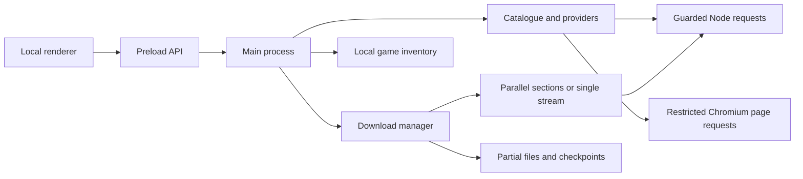

# Architecture

Atlas 0.2.4 is a Windows Electron application. The interface uses HTML, CSS and plain JavaScript; the main process uses CommonJS modules. There is no Atlas account service or hosted backend.

## Main components

| Component | Responsibility |
| --- | --- |
| `src/main.cjs` | Application lifecycle, local protocol, validated IPC handlers, windows, profile persistence and OS integration. |
| `src/preload.cjs` | Exposes the fixed `window.atlas` API through Electron's context bridge. |
| `src/renderer/` | Catalogue, game details, collections, installed-game view, queue, preferences and dialogs. |
| `src/catalog.cjs` | Catalogue sections, source-page parsing, search, caching and related resource links. |
| `src/catalog-refresh.cjs` | Main-process refresh scheduling, coalescing and last-successful catalogue state. |
| `src/providers.cjs` | Source-page/link expansion, supported paste decryption and file-host resolution. |
| `src/fast-session.cjs` | Uses an isolated Chromium session for supported FuckingFast page/form requests, without opening a page or evaluating scripts. |
| `src/ff-policy.cjs` | Supported FuckingFast endpoints, redirect boundaries and selected filename checks. |
| `src/net.cjs` | HTTPS validation, redirect handling and socket-level public-address checks for Node file requests. |
| `src/image-loader.cjs` | Bounded raster-image requests through the guarded Node transport, without browser-session credentials. |
| `src/downloads.cjs` | Persistent queue, file concurrency, pause/resume, URL refresh, transfer state and completed-file publication. |
| `src/parallel-download.cjs` | Section requests, resource validators, durable section checkpoints and single-stream fallback. |
| `src/rate-meter.cjs` | Recent transfer-rate measurement over a five-second window. |
| `src/installed-games.cjs`, `src/installed-scan.ps1` | Bounded, read-only inventory of installed-game records, manifests and executable version metadata. |
| `src/completion-action.cjs` | Session-only completion rules and cancellable countdown; OS execution is supplied by the main process. |

## Application and network boundaries

The main page is served from `atlas://app/index.html` through a small resource allowlist. It runs with context isolation and sandboxing enabled and Node integration disabled. IPC checks that calls originate from this window's expected main frame. Catalogue text is rendered as text, not injected as source HTML. Covers use an app image route backed by the guarded Node transport; the renderer's content policy blocks direct remote images. The loader checks public addresses and redirects, limits response size/time and accepts supported raster images. Image hosts still receive normal network requests and see the connection IP.

Protected host windows use host-specific sessions and do not load the application preload. They deny permissions and new popup windows, restrict navigation and network requests, and intercept supported archive downloads into the queue. The separate gameplay viewer also lacks download/file-control access. External links opened in the user's browser are governed by that browser's own settings.

The FuckingFast session adapter reads only supported root landing-page and matching form endpoints. It validates redirects, caps request lifetime and shares that host's verification session. It does not execute remote page scripts. Direct-file probes and file transfers continue through the Node transport. Chromium root-host DNS preflight is distinct from the Node transport's socket-level address validation; neither is a content-malware verdict.

## Download lifecycle

1. Providers expand a selected source into file links and check availability. Only checked, ready entries can be added through the application API.
2. The queue allows one to four simultaneous files. Independently, each file can use one, two or four connections.
3. Eligible files of at least 16 MiB use 8 MiB sections when their response ranges and resource validators can be checked. The engine requires a strong ETag or sufficiently old Last-Modified value for parallel work.
4. A private `.atlas-segments-*` support folder stores the data file and an atomically replaced checkpoint. Progress is recorded from confirmed written bytes rather than sparse file length. Pause and shutdown settle active requests and save the checkpoint.
5. Unsupported, limited, invalid or stalled parallel requests fall back to a single stream after workers have stopped. A valid contiguous prefix can be retained. A changed resource cannot be silently spliced into the old file.
6. The completed file is published only after transfer-size checks succeed. Publication refuses to replace an existing destination file. Legacy `.atlas-part` downloads remain on the single-stream resume path.

Some servers mishandle bounded range headers but support valid open-ended ranges. Atlas independently checks that alternate response format and intentionally stops each section at its assigned boundary. It does not treat inconsistent bounded headers as valid.

This validates the transfer representation and expected byte counts. Atlas does not automatically extract archives, run installers, scan downloaded contents or verify publisher hashes.

## Persistence and refresh

Preferences, queue state and collections are stored in `library.json` under Electron's application profile. Installed-game scan results and renderer-cache version state are separate files. Host and gameplay browser sessions use separate persistent partitions. These files can contain sensitive local paths and request data and are excluded from the repository.

Catalogue refresh runs in the main process at startup and every five minutes while Atlas remains open. Due checks also run after wake, focus or restore. Refreshes share pending work, preserve the previous good catalogue on failure and do not automatically download or patch games. The renderer defers changes when necessary to preserve an open dialog or the current view.

Queue completion actions are not persisted as an armed preference. Both close and shutdown wait for successful completion and then offer a 60-second cancellation window. Paused or failed files prevent the action, and changes to the queue can return it to waiting or cancel it.

## Tests and builds

`npm test` uses Node's test runner with local fixtures, injected transports and simulated clocks. Coverage includes queue/file integrity, range fallback, provider parsing, host policies, installed metadata, IPC behavior and renderer refresh/results. It does not establish current availability of external hosts.

The **Test** workflow runs the offline suite on Windows with Node 24. The manually dispatched **Build Windows preview** workflow installs locked dependencies, runs tests, builds the portable executable and uploads it with a SHA-256 checksum as a temporary workflow artifact. It does not publish a GitHub release. Actions are pinned to reviewed release commit IDs and use read-only repository permissions.

The separate **Publish Windows prerelease** workflow must be dispatched from `main`. Its build job runs the tests with read-only repository permissions. Only its release job receives write access: it verifies the build checksum, creates a draft, uploads the executable and checksum, and then publishes a prerelease. It refuses an existing version tag or release, including drafts. A failed upload leaves the draft unpublished for maintainer review.

See [BUILDING.md](BUILDING.md) for local development and build commands, and [SECURITY.md](../SECURITY.md) for reporting and data-handling guidance.
